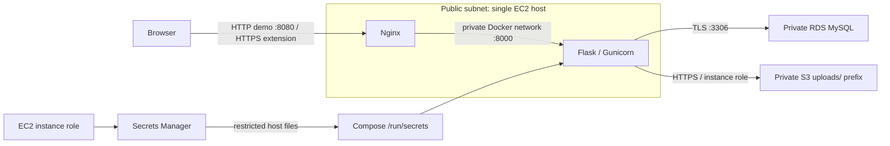

# Cloud-Native Multi-Container Application Deployment on AWS

Document Vault is a small Flask application for learning container operations and secure AWS integration. Register, sign in, upload UTF-8 `.txt` files, list your documents, download an owned document, and delete it. Maximum file size is 5 MiB; the multipart request limit is 6 MiB.

**Status:** implemented locally; see [validation results](docs/validation.md) for checks actually run. No AWS infrastructure has been created or deployment verified. This is a learning portfolio project, not a production security certification.

## Architecture



Local development substitutes a MySQL container and Moto S3 emulator. Moto object data is ephemeral; restarting/recreating it can lose file contents while MySQL metadata persists. AWS uses managed RDS and durable S3. One EC2 host is a single point of failure.

## Local setup

Use Linux, WSL2, or macOS with Docker Engine/Desktop running, Compose v2+, Python 3.12, and Bash. Windows PowerShell can run the Docker and Python commands directly; use Git Bash/WSL for `.sh` scripts. Restrict `.secrets` Windows ACLs to your user and Docker as needed; POSIX modes alone do not enforce Windows ACLs.

```bash
cp .env.example .env
python scripts/local-secrets.py
# Linux: parent directory protects development files, readable by container UID.
chmod 700 .secrets
docker compose -f compose.yaml -f compose.local.yaml build
docker compose -f compose.yaml -f compose.local.yaml up -d --wait mysql s3
docker compose -f compose.yaml -f compose.local.yaml run --rm --no-deps app python -c 'from application import create_app; a=create_app(); a.extensions["s3"].create_bucket(Bucket=a.config["BUCKET"])'
docker compose -f compose.yaml -f compose.local.yaml run --rm app flask --app application db upgrade
docker compose -f compose.yaml -f compose.local.yaml up -d --wait
```

Open http://127.0.0.1:8080. Register a dummy user with a 12+ character password, log in, upload a `.txt` file, confirm its contents on download, and delete it. Register another account to check isolation. Forms include CSRF tokens, so use the browser or automated tests instead of tokenless curl POSTs.

```bash
docker compose -f compose.yaml -f compose.local.yaml ps
docker compose -f compose.yaml -f compose.local.yaml logs --tail=100 app nginx
docker compose -f compose.yaml -f compose.local.yaml down
# DESTRUCTIVE: explicitly removes local database data, accounts and metadata:
docker compose -f compose.yaml -f compose.local.yaml down --volumes
```

Recreate the emulator bucket after an S3 container replacement. Do not mistake the emulator for durable local storage.

## Automated tests

```bash
python -m venv .venv
# Linux/macOS:
. .venv/bin/activate
# PowerShell alternative: .\.venv\Scripts\Activate.ps1
python -m pip install -r app/requirements-dev.txt
python -m pytest app/tests -q
bash scripts/validate.sh
# With local stack running:
python scripts/smoke-test.py
```

Tests use SQLite and Moto, and verify authentication, owner isolation, CSRF, upload validation, deletion, secret-file reads and compensation. They do not verify MySQL semantics, RDS TLS, EC2 networking, IAM policy enforcement, container hardening, or real S3.

## Repository map

```text
app/                 Flask factory, ORM models, templates, migrations, tests, Dockerfile
nginx/               Reverse proxy configuration
infrastructure/      Terraform network, EC2, RDS, S3, IAM, secret containers
scripts/             Local secrets, validation, bootstrap, secret retrieval, deployment, verification
docs/                Architecture, deployment, security, troubleshooting, cost, evidence, interview notes
compose.yaml         Cloud application/proxy services
compose.local.yaml   Development database and S3 emulator overlay
.env.example         Nonsecret local configuration
```

Start with [deployment](docs/deployment.md), [security](docs/security.md), [cost and cleanup](docs/cost-and-cleanup.md), [troubleshooting](docs/troubleshooting.md), and the [evidence checklist](docs/evidence-checklist.md). Supply your AWS account/profile, region, trusted public IPv4 CIDR, release image/tag or source commit, and optionally a domain for HTTPS. Cloud apply, publication, DNS, certificates and cleanup require separate explicit authorization.

## CV wording

“Implemented a Flask Document Vault with authenticated file ownership, private S3 integration, database migrations, hardened Docker Compose configuration, and Terraform definitions for EC2, private RDS MySQL, IAM and S3; documented secure deployment and automated local validation.”

Only add “deployed on AWS” after completing and capturing the cloud evidence. See [interview notes](docs/interview.md).
